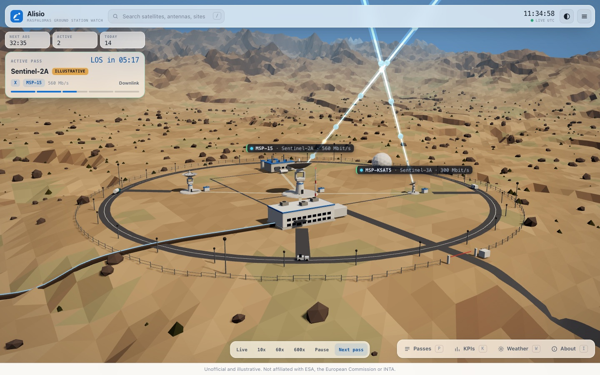
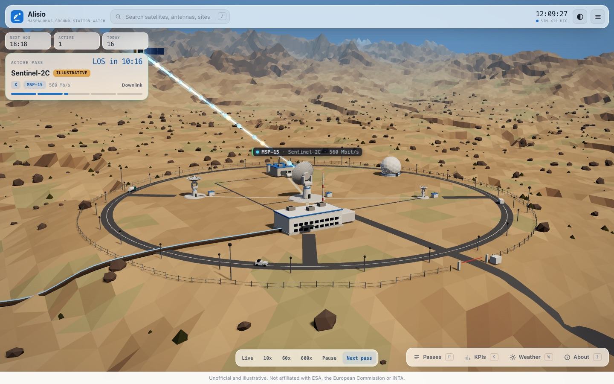

# Alisio - Maspalomas Ground Station Watch

**Live demo:** https://mcgregory99.github.io/alisio/

An unofficial, illustrative 3D world of the Maspalomas ground station on Gran Canaria. It shows real satellite passes (11 active Copernicus Sentinel missions, computed in the browser with SGP4) with antennas that track them, a data-flow animation and an operations dashboard.

> Unofficial and illustrative. Not affiliated with ESA, the European Commission or INTA.





## Interface

The scene fills the screen. A thin top bar, three chips (next AOS, active, today), an active-pass card and a time pill are always visible; everything else lives in drawers.

| Key | Action |
|---|---|
| `P` | Passes and tables |
| `K` | KPIs |
| `W` | Weather and EDRS relays |
| `I` | About the data |
| `H` | Hide the interface (the disclaimer stays) |
| `Esc` | Close the drawer, then the selection |
| `/` | Search |
| Scroll out past the limit | Earth from space with the satellites' orbits; `Esc` or zoom in to return ([details](docs/space-view.md)) |

Details of a satellite or antenna appear when you select it. Scene labels show only the selection and the active pass.

## Satellite models

Each Sentinel family has its own procedural model at real scale (S-1 with its long radar antenna, S-2, S-3, S-5P, S-6). Open `?models=1` to see them side by side. Dimensions and sources are in [docs/sentinel-models.md](docs/sentinel-models.md); the S-5P and S-6 sizes are estimates.

Elements are tagged `verified` (confirmed from public sources) or `illustrative` (artistic placeholder or assumption). The product uses no ESA, Copernicus or INTA logos.

## Run

There is no build step. Serve the folder over HTTP and open it in a browser (Node 22 or later):

```sh
npm start            # http://127.0.0.1:8080/
PORT=8795 npm start  # another port
```

`file://` is not supported. Three.js r160 is loaded from a CDN through the import map in `index.html`, so the first load needs internet access; satellite.js 7.1.0 is vendored in `vendor/`.

## Tests

```sh
npm test             # node --test "test/**/*.test.mjs"
```

The core (`src/core`) is DOM-free and covered by unit tests; scene and UI keep their pure logic in `*-math.mjs` and `*-model.mjs` files that are tested the same way.

## Data sources

- **Orbits**: CelesTrak GP data in OMM JSON (group `NAME=SENTINEL`). The app ships an embedded snapshot (epoch 2026-10-14) and works fully offline from it. Nothing is requested on page load.
- **Live refresh**: only when you press "Refresh orbit data". At most one request every 2 hours; a 403 or 404 stops further attempts in the session and the current data stays active. The header shows source, epoch and age, with a warning past 7 days.
- **Station and missions**: plain data in `src/data/`. Maspalomas is described as data, so another station record renders its own antennas with no code change.

## Extras

- **Weather**: pick clear, calima dust haze, Atlantic cloud/rain or strong trade wind. This is an illustration you choose, not a live feed. Rain adds a small X-band fade (at most 3 dB, shown in the detail panel); a strong trade wind stows the antennas and affected passes are marked unserved.
- **EDRS relays**: an optional layer (off by default) with EDRS-A (9 E) and EDRS-C (31 E) as historical, optional relays of unverified status.

## Notes on accuracy

- **Coast (amended R4.1, superseded)**: the coast used to be compressed for legibility. It is now at the distance ESA reports: the sea lies about 1,750 m south of the station, the antenna platform stands 205 m up (ESA, 205.1 m above the WGS-84 ellipsoid) and the in-scene label reads "coast ~1.75 km (ESA)" (verified). Only those two numbers, the site (Montana Blanca) and the roughly 1.6 km distance to the Las Palmas-Mogan road are verified. The slope between them, the barrancos, the dune patch, the coastal town and the access road alignment are illustrative. See [docs/orography.md](docs/orography.md) for every fact and its source versus every illustrative choice. The campus layout inside the fence is also illustrative (no public site plan was found).
- **Bands**: payload downlink is X-band. Sentinel TT&C prime is Kiruna; S-band capability at Maspalomas is shown but not claimed as prime.
- **Reference point**: look angles are computed from the station geodetic origin; dish pointing uses each antenna pivot.
- Sky positions are directions, not distances. Doppler uses an illustrative carrier frequency.
